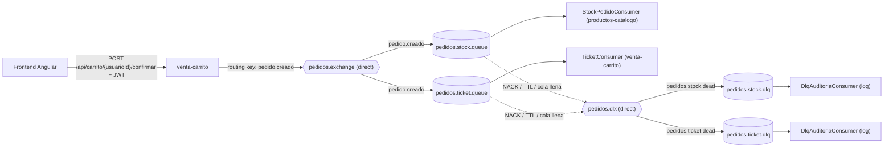

# Pedidos360 · Backend

Backend de Pedidos360: tres microservicios Java 17 / Spring Boot 3.2 que se comunican de forma asíncrona con **RabbitMQ** y validan el **JWT de Azure AD** (IDaaS) en cada petición.

| Microservicio | Puerto | Responsabilidad | Rol en RabbitMQ |
|---|---|---|---|
| `productos-catalogo` | 8081 | CRUD de productos y stock | **Consumidor**: descuenta stock (`pedidos.stock.queue`) |
| `venta-carrito` | 8082 | Carrito, confirmación de pedidos, tickets | **Productor** de `pedido.creado` y **consumidor** de tickets (`pedidos.ticket.queue`) |
| `rabbitmq-admin` | 8083 | Administración del broker | API REST para crear y eliminar colas, exchanges y bindings |

---

## 1. Flujo de mensajería

Cuando el usuario confirma su carrito, `venta-carrito` responde de inmediato (**202 Accepted**) y publica el evento `pedido.creado`. El exchange entrega una copia a cada cola enlazada y cada microservicio hace su parte de forma independiente.



### Topología

| Exchange | Tipo | Routing key | Cola | Consumidor | A dónde van los fallidos |
|---|---|---|---|---|---|
| `pedidos.exchange` | direct | `pedido.creado` | `pedidos.stock.queue` | `StockPedidoConsumer` (catálogo) | `pedidos.dlx` → `pedidos.stock.dlq` |
| `pedidos.exchange` | direct | `pedido.creado` | `pedidos.ticket.queue` | `TicketConsumer` (carrito) | `pedidos.dlx` → `pedidos.ticket.dlq` |
| `pedidos.dlx` | direct | `pedidos.stock.dead` | `pedidos.stock.dlq` | `DlqAuditoriaConsumer` (catálogo) | — |
| `pedidos.dlx` | direct | `pedidos.ticket.dead` | `pedidos.ticket.dlq` | `DlqAuditoriaConsumer` (carrito) | — |

**Políticas de retención** (argumentos de las colas):

| Cola | `x-message-ttl` | `x-max-length` | Efecto |
|---|---|---|---|
| Colas de trabajo | 60 000 ms | 1 000 | Un pedido sin consumir por 60 s, o que excede el tope, pasa a la DLQ |
| DLQ | 86 400 000 ms (24 h) | — | Los mensajes fallidos se conservan un día para analizarlos |

---

## 2. Configuración centralizada

**Ningún nombre de cola, exchange o routing key está escrito en el código.** Todo se define en `application.yml` de cada microservicio, bajo `pedidos360.rabbitmq`, con la misma estructura:

```yaml
pedidos360:
  rabbitmq:
    exchanges:   { pedidos: pedidos.exchange, dead-letter: pedidos.dlx }
    routing-keys: { pedido-creado: pedido.creado }
    colas:
      stock: { nombre: pedidos.stock.queue, dlq: pedidos.stock.dlq, dlq-routing-key: pedidos.stock.dead }
    retencion:  { ttl-mensaje-ms: 60000, max-mensajes: 1000, ttl-dlq-ms: 86400000 }
    reintentos: { max-intentos: 3, intervalo-inicial-ms: 1000, multiplicador: 2.0 }
```

| Clase | Qué hace |
|---|---|
| `config/RabbitMQProperties` | Lee ese bloque del YAML como un objeto tipado y validado; si falta un nombre, la app no arranca |
| `config/RabbitMQConfig` | Declara los beans `Queue`, `Exchange` y `Binding` de cada caso de uso, con el diagrama de la ruta documentado en el código |
| `@RabbitListener(queues = "${...}")` | Los consumidores leen el nombre de la cola desde el YAML |

**Separación de responsabilidades.** Los servicios de negocio (`ProductoService`, `CarritoService`, `TicketService`) no conocen RabbitMQ. `CarritoService` publica a través de la interfaz `PedidoEventPublisher`; su implementación `RabbitPedidoEventPublisher` está en el paquete `messaging`.

```
<microservicio>/src/main/java/com/pedidos360/<servicio>/
├── config/        RabbitMQConfig, RabbitMQProperties, SecurityConfig
├── controller/    REST
├── service/       logica de negocio (sin RabbitMQ)
├── dto/           PedidoCreadoEvent (contrato del mensaje)
└── messaging/
    ├── pedidos/   productor / consumidor del dominio "pedidos"   (StockPedidoConsumer, RabbitPedidoEventPublisher)
    ├── tickets/   consumidor del dominio "tickets"               (TicketConsumer)
    ├── dlq/       auditoria de mensajes muertos                  (DlqAuditoriaConsumer)
    └── comun/     LectorMensajes, EjecutorConReintentos, ClasificadorErrores
```

---

## 3. Confirmación de mensajes (ACK / NACK) y manejo de errores

Los consumidores trabajan con `acknowledge-mode: manual` y deciden de forma explícita qué responderle al broker:

| Situación | Ejemplo | ¿Se reintenta? | Respuesta al broker | Resultado |
|---|---|---|---|---|
| Procesado correctamente | Stock descontado | — | `basicAck` | Sale de la cola |
| Mensaje inválido | JSON roto, falta `pedidoId`, lista vacía | **No** | `basicNack(requeue=false)` | DLQ inmediata |
| Regla de negocio | Producto inexistente, stock insuficiente | **No** | `basicNack(requeue=false)` | DLQ inmediata |
| Error recuperable | BD caída, timeout | **Sí**: 3 intentos (espera 1 s y 2 s) | `basicAck` si se recupera; si no, `basicNack(requeue=false)` | DLQ tras 3 intentos |
| Servicio detenido en medio de un reintento | Apagado de la app | — | `basicNack(requeue=true)` | Vuelve a la cola para otra instancia |

- **Nunca se reencola un mensaje que falló por sus datos**: volvería a fallar para siempre (un *poison message*).
- `ClasificadorErrores` decide qué es recuperable y `EjecutorConReintentos` aplica el backoff exponencial configurado en el YAML.
- **Todo mensaje que llega a la DLQ queda en el log**: el consumidor lo registra al rechazarlo y `DlqAuditoriaConsumer` registra la cola de origen y el motivo según el header `x-death` (`rejected`, `expired` o `maxlen`).
- **El productor también registra los mensajes no entregados**: con *publisher confirms* y `mandatory=true`, un mensaje que el broker rechaza o que no llega a ninguna cola queda en el log (`ConfirmCallback` / `ReturnsCallback`).

---

## 4. API del administrador de RabbitMQ (`rabbitmq-admin`, puerto 8083)

Documentación interactiva: **http://localhost:8083/swagger-ui.html**

| Método | Ruta | Descripción | Respuestas |
|---|---|---|---|
| POST | `/api/rabbitmq/queues` | Crear cola (opcional: DLQ, TTL, máx. mensajes, quorum) | 201, 400, 409 |
| GET | `/api/rabbitmq/queues/{nombre}` | Mensajes pendientes y consumidores | 200, 404 |
| DELETE | `/api/rabbitmq/queues/{nombre}` | Eliminar cola | 204, 404 |
| POST | `/api/rabbitmq/exchanges` | Crear exchange (DIRECT, TOPIC, FANOUT, HEADERS) | 201, 400, 409 |
| DELETE | `/api/rabbitmq/exchanges/{nombre}` | Eliminar exchange | 204, 404 |
| POST | `/api/rabbitmq/bindings` | Enlazar cola ↔ exchange con una routing key | 201, 400, 404 |
| DELETE | `/api/rabbitmq/bindings?exchange=&cola=&routingKey=` | Eliminar binding | 204, 404 |

Ejemplo:

```http
POST /api/rabbitmq/queues
{ "nombre": "notificaciones.email.queue", "conDlq": true, "ttlMs": 60000, "maxMensajes": 500 }

201 Created
{ "mensaje": "Cola creada correctamente",
  "recursos": ["notificaciones.email.queue", "notificaciones.email.queue.dlx", "notificaciones.email.queue.dlq"] }
```

**Validaciones** (DTO con Bean Validation y `GlobalExceptionHandler`):

- El nombre es obligatorio, tiene de 3 a 100 caracteres (letras, números, `.`, `_` o `-`) y no puede empezar con `amq.`, un prefijo que RabbitMQ reserva para sus recursos.
- `ttlMs` y `maxMensajes` deben ser positivos y con tope.
- Una cola `QUORUM` debe ser durable.
- El tipo de exchange solo acepta valores válidos; si no, la respuesta indica cuáles son.
- Un binding solo se crea si la cola y el exchange existen. Una cola o un exchange que ya existe responde 409.
- Todos los errores usan el mismo formato: `{ timestamp, status, error, detalles[], ruta }`.

`RabbitAdminService` es la única clase que usa `RabbitAdmin`; el controlador solo llama a sus métodos.

---

## 5. Seguridad

Todos los endpoints exigen un JWT válido de Azure AD; `SecurityConfig` valida el emisor (tenant) y la audiencia (client id). Las únicas rutas públicas son `/ping` y la documentación Swagger. El test `SeguridadJwtTest` comprueba que una petición sin token recibe 401.

Solo para pruebas locales del administrador sin token: `SEGURIDAD_JWT_HABILITADO=false`.

---

## 6. Cómo ejecutar

1. **Levantar RabbitMQ y MySQL** con el `docker-compose.yml` del repositorio de infraestructura (`docker compose up -d`). Las bases `catalogo_db` y `carrito_db` se crean solas.
2. **Compilar y correr los tests** de los tres microservicios, desde esta carpeta:
   ```bash
   mvn clean test
   ```
3. **Levantar cada microservicio** (una terminal por cada uno):
   ```bash
   cd productos-catalogo && mvn spring-boot:run
   cd venta-carrito      && mvn spring-boot:run
   cd rabbitmq-admin     && mvn spring-boot:run
   ```
   Al arrancar, `productos-catalogo` y `venta-carrito` crean solos sus exchanges, colas, DLQ y bindings. Se pueden ver en http://localhost:15672 (admin / admin123).

> **Si al arrancar aparece `PRECONDITION_FAILED - inequivalent arg`:** en el broker ya existe una cola o un exchange con ese nombre pero con otra configuración (por ejemplo, uno creado a mano en versiones anteriores). Hay que eliminarlo desde el dashboard o con `DELETE` del administrador y reiniciar el microservicio. Lo mismo aplica si se cambian el TTL o el largo máximo en el YAML: RabbitMQ no permite modificar los argumentos de una cola que ya existe.

### Variables de entorno

| Variable | Por defecto | Uso |
|---|---|---|
| `DB_HOST`, `DB_PORT`, `DB_NAME`, `DB_USER`, `DB_PASSWORD` | localhost:3306, root/root | Base de datos (RDS en la nube) |
| `RABBITMQ_HOST`, `RABBITMQ_PORT`, `RABBITMQ_USER`, `RABBITMQ_PASSWORD` | localhost:5672, admin/admin123 | Broker |
| `AZURE_TENANT_ID`, `AZURE_CLIENT_ID` | App Registration del proyecto | Validación del JWT |
| `CORS_ORIGINS` | `http://localhost:4200,http://52.200.216.83:4200` | URL del frontend (cambia con la IP de la EC2) |
| `DLQ_AUDITOR_ACTIVO` | `true` | `false` deja los mensajes acumulados en la DLQ para verlos en el dashboard |
| `SEGURIDAD_JWT_HABILITADO` | `true` | Solo `rabbitmq-admin`: `false` para probar sin token en local |

En PowerShell: `$env:DLQ_AUDITOR_ACTIVO="false"; mvn spring-boot:run`

---

## 7. Pruebas y evidencias

La colección `postman/Pedidos360-backend.postman_collection.json` trae todas las peticiones. Basta con pegar el JWT en la variable `token`.

### Pruebas automatizadas (`mvn clean test`)

| Microservicio | Qué se prueba |
|---|---|
| productos-catalogo | ACK, NACK a la DLQ y reintentos del consumidor (`StockPedidoConsumerTest`) · descuento de stock (`ProductoServiceTest`) · beans de RabbitMQ con DLX/TTL (`RabbitMQConfigTest`) · 401 sin JWT (`SeguridadJwtTest`) · CRUD (`ProductoControllerTest`) |
| venta-carrito | Confirmación de pedido y carrito vacío (`CarritoServiceTest`, `CarritoControllerTest`) · publicación en exchange y routing key correctos (`RabbitPedidoEventPublisherTest`) · consumidor de tickets (`TicketConsumerTest`) · formato del ticket (`TicketServiceTest`) |
| rabbitmq-admin | Rutas y códigos HTTP, y validaciones 400, 404 y 409 (`RabbitAdminControllerTest`, `RabbitAdminServiceTest`) |

### Pruebas manuales con el dashboard de RabbitMQ

Se puede publicar un evento a mano sin pasar por el frontend: **Exchanges → `pedidos.exchange` → Publish message**, con routing key `pedido.creado`, la propiedad `content_type = application/json` y este payload:

```json
{"pedidoId":"DEMO-1","usuarioId":"demo","total":9980,
 "items":[{"productoId":1,"nombreProducto":"Hamburguesa","cantidad":2,"precioUnitario":4990}]}
```

| # | Escenario | Cómo provocarlo | Qué se ve en los logs y el dashboard |
|---|---|---|---|
| 1 | Flujo completo | Confirmar un carrito desde el frontend o Postman, o publicar el JSON de arriba | `[PRODUCTOR] ... publicado` · `[STOCK] OK ... ACK` · `[TICKET] Comprobante generado` · el stock del producto baja |
| 2 | Regla de negocio | Publicar con `"productoId":999` o `"cantidad":9999` | `[STOCK] Error NO recuperable ... -> DLQ` · `[DLQ] ... motivo: rejected` |
| 3 | Mensaje inválido | Publicar `hola` (no es JSON) | NACK inmediato → `[DLQ] ... motivo: rejected` en ambas DLQ |
| 4 | Error recuperable | `docker stop mysql-server` y publicar el JSON | `[STOCK] Error recuperable en intento 1/3 ... 2/3` → DLQ. Con `docker start mysql-server` a tiempo, termina en ACK |
| 5 | Retención (TTL) | Detener `productos-catalogo`, publicar y esperar 60 s | El mensaje pasa a `pedidos.stock.dlq` con motivo `expired` |
| 6 | Ver la DLQ con mensajes | Levantar con `DLQ_AUDITOR_ACTIVO=false` y repetir el escenario 2 | **Queues → `pedidos.stock.dlq` → Get messages** muestra el mensaje y su header `x-death` |
| 7 | Administrador | Swagger o Postman: crear cola con DLQ, exchange y binding; luego eliminarlos | 201 / 204, y los recursos aparecen y desaparecen del dashboard |
| 8 | Validaciones | Crear una cola con `"nombre": ""`, `"amq.x"` o `QUORUM` con `durable:false` | 400 con el detalle de cada error |

---

## 8. Integración con frontend e infraestructura

- **Frontend:** nuevo endpoint `POST /api/carrito/{usuarioId}/confirmar` (con JWT). Responde 202 y el JSON del pedido. Si el carrito está vacío responde 422, y si RabbitMQ no está disponible, 503.
- **Infraestructura:** hay que desplegar el nuevo microservicio `rabbitmq-admin` en el puerto 8083 (ya está dentro del rango 8080–8090 del security group). En cada contenedor se pasa `RABBITMQ_HOST` y `CORS_ORIGINS`.
- **Endpoints retirados:** `/api/admin/broker/**` (antes en catálogo), reemplazado por `rabbitmq-admin`, y `/api/carrito/test-mensaje`, reemplazado por la confirmación real. La cola antigua `pedidos.cola` se puede eliminar.
